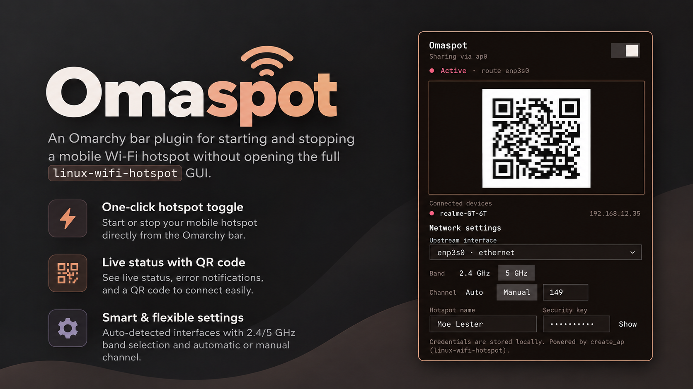

# Omaspot

Omaspot is an Omarchy bar plugin for starting and stopping a mobile Wi-Fi
hotspot without opening the full `linux-wifi-hotspot` GUI. It uses the same
`create_ap` backend as the `linux-wifi-hotspot` AUR package and follows the
Omarchy shell's native theme and panel conventions.

Features:

- One-click hotspot toggle from the Omarchy bar
- Live status and useful error notifications
- QR code that appears while the hotspot is active
- List of recently connected clients, with the currently associated ones marked
- Auto-detected Wi-Fi and upstream interfaces
- 2.4 GHz and 5 GHz band selection
- Automatic or manual channel selection
- Persistent per-user settings stored outside the plugin checkout
- Credentials sent over stdin instead of command-line arguments
- Checks whether the hotspot backend is installed and offers its install
  command when missing

## Requirements

On a standard Omarchy installation, the only additional package Omaspot asks
you to install is
[linux-wifi-hotspot](https://github.com/lakinduakash/linux-wifi-hotspot),
which provides `create_ap`, the same hotspot engine used by the `wihotspot`
GUI. Install it with:

```sh
yay -S --needed linux-wifi-hotspot
```

Omarchy already supplies the supporting system tools, QR encoder, and
`wl-clipboard` used for clipboard copy and paste. The package manager resolves
the hotspot package's own dependencies during installation.

Omaspot enables 802.11n on both bands and requests 802.11ac with an 80 MHz
channel width on 5 GHz. The adapter, connected Wi-Fi channel, and regulatory
domain may limit the negotiated mode or width.

When the panel opens, it checks for `create_ap`. If it is missing, the hotspot
controls are replaced with the `linux-wifi-hotspot` install command. Run it in
a terminal, reopen the panel, and Omaspot continues as normal. See
[First run](#first-run).

To check the same state from a terminal:

```sh
backend/omaspotctl doctor
```

## Install

Omarchy accepts `plugin install` as an alias for `plugin add`. Install and
enable Omaspot with:

```sh
omarchy plugin install https://github.com/DeV-433/Omaspot.git --enable --yes
```

The equivalent command on Omarchy versions that show the newer verb is:

```sh
omarchy plugin add https://github.com/DeV-433/Omaspot.git --enable --yes
```

The installer validates `manifest.json`, places the plugin under
`~/.config/omarchy/plugins/io.github.devanshu.omaspot`, rescans the shell, and
adds the widget to the bar. Omit `--enable` if you want to install it first
and enable it later:

```sh
omarchy plugin enable io.github.devanshu.omaspot
```

Omaspot runs as plugin code inside the long-lived Omarchy shell process. Review
the repository before installing plugins from any source you do not trust.

After installing the plugin, click the bar icon. If the `linux-wifi-hotspot`
package is missing, the panel offers its install command — see
[First run](#first-run).

## First run

The check runs on **every** open, not just the first, so returning from a
terminal after installing is enough — there is nothing to reload and no
restart to perform. The toggle is hidden while the gate is up, and a start is
refused outright, so a hotspot can never be launched without `create_ap`
behind it.

The check comes from `omaspotctl doctor`. It checks for `create_ap` and, if
missing, returns the single `linux-wifi-hotspot` install command. The copyable
command is composed in the backend rather than assembled in QML.

The copy button uses `wl-copy` from `wl-clipboard`, quoted with
`Util.shellQuote` so the command reaches it as a single argument. Omaspot
checks the install command matches a plain `yay -S --needed <packages>` shape
before offering it, so a malformed or spoofed backend response cannot put
arbitrary text on the clipboard.

The three settings inputs remain read-only to Qt's native clipboard watcher.
Typing and selection are handled by Omaspot, and paste explicitly invokes
`wl-paste` with a two-second timeout and a 256-byte output cap. Standard
Omarchy installations include `wl-clipboard`, which provides Ctrl+V and
Shift+Insert paste support.

## Defaults and settings

A fresh installation starts with these safe, generic defaults:

- Hotspot name: `Omaspot`
- Security key: `omaspot123` — change this before sharing the network
- Band: `2.4 GHz`
- Channel: automatic
- Upstream interface: automatic detection

The repository contains no machine-specific SSID, password, interface, or
state file. Once you edit settings, Omaspot stores them locally at:

```text
~/.local/state/omarchy/settings/io.github.devanshu.omaspot.json
```

That file is not part of the plugin repository and is never uploaded by the
plugin installer.

## Use

Click the Omaspot icon in the bar to open the panel. Choose the upstream
interface, band, and channel policy if needed, update the hotspot name and
security key, then use the switch. The QR code is generated only while the
hotspot is active. While it is active, the panel also lists the clients that
have joined most recently; the list scrolls rather than growing the flyout.

If another application already started `create_ap`, Omaspot detects it and
can stop it through the same backend. It also loads `/etc/create_ap.conf` when
present, while the panel's live band, channel, and credentials take priority.

## Development

Validate the plugin from a checkout with:

```sh
omarchy plugin validate .
```

Optional local checks:

```sh
node - <<'NODE'
const model = require('./Model.js')
const defaults = model.defaults()
if (defaults.band !== '2.4' || defaults.channelMode !== 'auto') {
  throw new Error('unexpected defaults')
}
console.log('Model defaults OK')
NODE

bash -n backend/omaspotctl
```

The backend exposes the small protocol used by the QML panel:
`status`, `interfaces`, `deps`, `doctor`, `clients`, `start`, `stop`, and `qr`.

`clients` is read-only and never escalates: it reports the tab-separated
`mac`, `ip`, `hostname`, `state` of each client it finds, newest lease first.
It reads the validated instance state directory plus the unprivileged `iw`
station table rather than `create_ap --list-clients`, which needs root and
would prompt on every refresh. Hostnames come from DHCP and are therefore
attacker-controlled, so every field is validated against a strict pattern
before it reaches the panel.

## Instance state and trust

`create_ap` records per-instance state under the world-writable `/tmp`, where
any local user can create a `/tmp/create_ap.<iface>.conf.<id>` directory owned
by themselves. Because `create_ap --stop` signals whatever pid it is given, a
planted directory would otherwise turn the stop path into an arbitrary root
signal. Omaspot therefore treats nothing under `/tmp` as trustworthy until it
has been proven root-owned and unwritable by anyone else, refuses symlinks, and
matches every pid against `/proc` — uid, `argv`, and start time — before it
reaches a privileged command.

### The shared `create_ap.common.conf`

`create_ap` has the same weakness one level up, and it lives upstream rather
than in this plugin. It adopts `/tmp/create_ap.common.conf` with a bare
`mkdir -p`, then during cleanup runs as root:

```sh
for x in $COMMON_CONFDIR/*.pid; do [[ -f $x ]] && kill -9 $(cat $x); done
```

and restores `/proc/sys/net/ipv4/ip_forward`, `bridge-nf-call-iptables` and
`${IFACE}_forwarding` from files in that same directory. Anyone who can create
the directory first therefore gets an arbitrary root `SIGKILL` on the next
teardown, and arbitrary writes to `/proc/sys`. This affects every `create_ap`
user — `wihotspot-gui` ships under the same polkit action with the same
exposure — and it remains unfixed upstream.

`create_ap` sets `umask 077` before creating the directory, so one it creates
itself is `0700` and root-owned. Only a directory that already existed and
belongs to someone else is dangerous, so Omaspot refuses to start **or stop**
while it finds one, and points at the single command that clears it:

```sh
sudo rm -rf /tmp/create_ap.common.conf
```

Only root can remove someone else's directory out of a sticky `/tmp`.

This cannot be sanitized from the caller's side: polkit authorizes
`exec.path == /usr/bin/create_ap` exactly, so wrapping the invocation in a root
script that cleaned the directory first would lose the action and prompt on
every toggle. The real fix has to land upstream.

## License

MIT. See [LICENSE](LICENSE).
