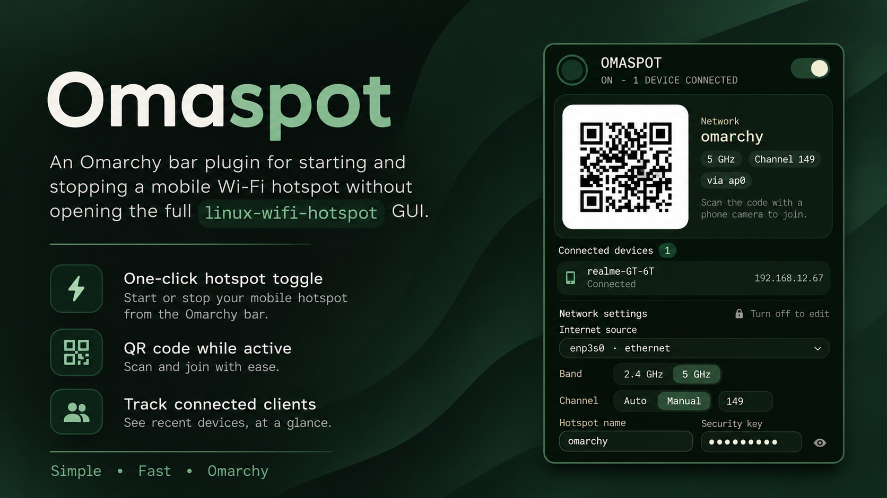

# Omaspot

An Omarchy bar plugin for turning a Wi-Fi hotspot on and off without opening
the full `linux-wifi-hotspot` GUI. It drives the same `create_ap` backend and
follows the Omarchy shell's theme.

## Features

- One-click hotspot toggle from the bar
- A bar icon that shows off, starting and broadcasting at a glance, with a
  bead for each connected device
- QR code to join, shown while the hotspot is on
- List of connected devices
- Auto-detected Wi-Fi card and internet source
- 2.4 GHz or 5 GHz, with automatic or manual channel
- Shares a Wi-Fi connection over Wi-Fi from the same card
- Plain-language errors with a next step, and **Copy log** for a full
  diagnostic report
- Notices a hotspot that stopped during suspend instead of showing it as on

## Requirements

Omaspot needs
[linux-wifi-hotspot](https://github.com/lakinduakash/linux-wifi-hotspot)
(which provides `create_ap`), `dnsmasq` and `iptables`:

```sh
yay -S --needed linux-wifi-hotspot dnsmasq iptables
```

If any are missing, the panel shows the install command instead of the
hotspot controls. Reopen the panel after installing; no restart is needed.

## Install

```sh
omarchy plugin add https://github.com/DeV-433/Omaspot.git --enable --yes
```

To update later:

```sh
omarchy plugin update io.github.devanshu.omaspot
```

Omaspot runs inside the Omarchy shell process. As with any plugin, review the
code before installing it from a source you don't trust.

## Use

Click the bar icon to open the panel. Pick the internet source, band and
channel if needed, set the hotspot name and security key, then flip the
switch.

A fresh install starts with the name `Omaspot` and the key `omaspot123`.
**Change the key before sharing the network.** Settings are saved per user in
`~/.local/state/omarchy/settings/io.github.devanshu.omaspot.json`, outside the
plugin folder.

### Sharing Wi-Fi over Wi-Fi

Most Wi-Fi cards can only run a hotspot on the same channel as the network
they're connected to. With the channel on **Auto**, Omaspot follows that
network's band and channel, and the panel shows the ones actually in use.
A manual channel only works if it matches the connected network.

### When something goes wrong

The panel says what failed and what to try next. For failures reported by
`create_ap`, **Copy log** puts a full diagnostic report on the clipboard,
with the security key removed, ready to paste into an issue. The report is
kept in memory only.

## Security note

`create_ap` keeps shared state in `/tmp/create_ap.common.conf`. If that folder
exists and isn't owned by root, another local user could abuse it to make
`create_ap` kill processes or change network settings as root. This is an
upstream `create_ap` issue. Omaspot refuses to start or stop the hotspot while
the folder is unsafe and shows how to clear it:

```sh
sudo rm -rf /tmp/create_ap.common.conf
```

## Development

```sh
omarchy plugin validate .
bash -n backend/omaspotctl
backend/omaspotctl doctor   # check dependencies from a terminal
```

## License

MIT. See [LICENSE](LICENSE).
